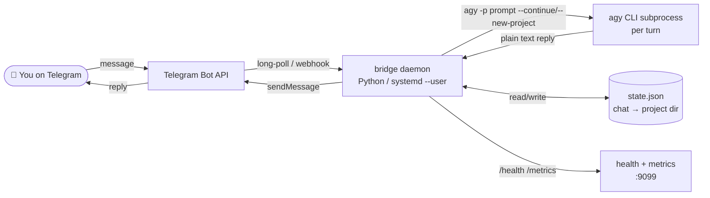

# 🤖 antigravity-telegram-bridge

[](https://www.python.org/downloads/)
[](./tests)
[](./LICENSE)
[](https://systemd.io/)
[](https://antigravity.google)

Chat with the [Antigravity CLI](https://antigravity.google) (`agy`) from Telegram.

Forked from `hah23255/kimi-to-im` and adapted to drive Google's `agy` CLI instead of the discontinued `gemini` CLI. Each Telegram chat gets its own `agy` project/working directory so sessions persist across messages while staying isolated from one another.

**Self-hosted · single-user · Python · systemd-supervised · webhook-ready**

---

### What it is
A Telegram bridge daemon for the Google Antigravity CLI (`agy`), allowing persistent, isolated code editing sessions over Telegram chats. Version: `0.2.0`.

### Features
| Feature | Status |
|---|---|
| Telegram ↔ `agy` messaging (persistent `stream-json` worker + live progress streaming) | ✅ |
| Per-chat project isolation (`--new-project` / `--continue`) | ✅ |
| Dynamic `agy models` sync + inline keyboard (`/model`, `/usage`, `/reset`) | ✅ |
| Auto-compaction threshold (`AGY_CLI_AUTO_COMPACT_OVERRIDE`) & custom `--settings` | ✅ |
| Photo + document upload support with configurable safety routing | ✅ |
| Configurable file type allowlist (pass/warn/hold/block per category) | ✅ |
| Per-user rate limiting with sliding window | ✅ |
| Memory health gate with automatic self-restart | ✅ |
| Zombie subprocess reaping + garbage collection | ✅ |
| Multi-user FIFO turn queue | ✅ |
| Webhook mode with secret-token verification | ✅ |
| Health endpoint (`/health`) and Prometheus metrics (`/metrics`) | ✅ |
| `systemd --user` service | ✅ |
| Plugin tool for `agy` (`bridge start/stop/status/logs/setup`) | ✅ |
| Full pytest suite, 100 % pass | ✅ |

### Quickstart

You need: Linux with `systemd --user`, Python ≥3.11, `uv`, a working `agy` CLI on `PATH`, and an authenticated `agy` session.

1. **Get a Telegram bot token** from [@BotFather](https://t.me/BotFather).
2. **Get your Telegram user ID** from [@userinfobot](https://t.me/userinfobot).
3. **Authenticate `agy` once** in a terminal:
   ```bash
   agy
   # complete the browser OAuth flow
   ```
4. **Install the bridge.**
   ```bash
   git clone https://github.com/zxc50389/agy-to-im.git \
     ~/.gemini/extensions/antigravity-telegram-bridge
   cd ~/.gemini/extensions/antigravity-telegram-bridge
   ./install.sh
   cp config.example.json config.json
   chmod 600 config.json
   $EDITOR config.json   # fill bot_token + allowed_user_ids
   systemctl --user start antigravity-telegram-bridge.service
   ```

For the full step-by-step guide see `docs/deployment.md`. Day-to-day operations are in `docs/operations.md`.

### Configuration
```json
{
  "telegram": {
    "bot_token": "1234567890:...",
    "allowed_user_ids": [123456789],
    "allowed_chat_ids": []
  },
  "agy": {
    "chats_root": "",
    "default_workdir": "",
    "model": "gemini-4-neon-high",
    "mode": "code",
    "auto_compact": "200K",
    "model_prefixes": ["gemini-4-", "gemini-pro-orchestrator"],
    "stream_mode": true,
    "settings": {}
  }
}
```

### Text Commands
* `/model` - Pick a model for this chat (inline keyboard)
* `/usage` - Show Antigravity model quota usage
* `/start` - Welcome message
* `/help` - Usage help
* `/status` / `/info` - Session summary
* `/settings` - Inline control panel (model, mode, reset)
* `/reset` - Start a fresh `agy` project for this chat
* `/image on|off` - Toggle photo processing
* `/files` - List inbox files
* `/files clean` - Purge all inbox files
* `/queue` - Queue status

### Architecture Mapping


### Fault Handling Manual
| Status / Error | Root Cause | Mitigation |
| :--- | :--- | :--- |
| `ModuleNotFoundError: No module named 'httpx'` | The daemon was started using the global python binary instead of the local virtual environment `.venv`. | Ensure the systemd unit or script runs within the project's virtual environment (`.venv/bin/python`). |
| Unauthorized / Token Rejected | The Telegram Bot API token is incorrect, expired, or blocked. | Check that `config.json` contains a valid bot token from BotFather. |
| Access Denied (User ID Whitelist) | The Telegram user ID sending messages is not in the whitelisted `allowed_user_ids` config array. | Add your user ID obtained from userinfobot to `config.json` and restart the daemon. |
| `systemd --user` service fails | The systemd user daemon cannot start the service (commonly due to missing user lingering). | Run `loginctl enable-linger` as root/user to allow user session daemons to run when logged out. |
| Webhook verification fails | The incoming webhook payloads are rejected due to mismatched `X-Telegram-Bot-Api-Secret-Token` headers. | Check that `CTI_WEBHOOK_SECRET` (or the derived secret token) matches what was registered with `setWebhook`. |
| Chat directory traversal error | A request attempted to read/write paths outside of the whitelisted `chats_root`. | Clean state database `state.json` and ensure no inputs bypass path validation hooks in `src/state.py`. |

### Common Issues & Golden Rules
* **Golden Rule 1: Default-Deny Access Control.** Always whitelists allowed user/chat IDs. Never run public-facing bridges without a strict filter list to prevent code execution by unauthorized users.
* **Golden Rule 2: Virtual Environment Isolation.** Always execute the daemon and tools inside `.venv/` to prevent package version conflicts and runtime import issues.
* **Golden Rule 3: Webhook Secret-Token Protection.** Under webhook deployment, always enforce `X-Telegram-Bot-Api-Secret-Token` verification on incoming requests to prevent spoofed payload injection.
* **Golden Rule 4: Systemd User session lingering.** Always verify that `loginctl enable-linger` is active for the target user, guaranteeing the bridge daemon persists across terminal logouts.
